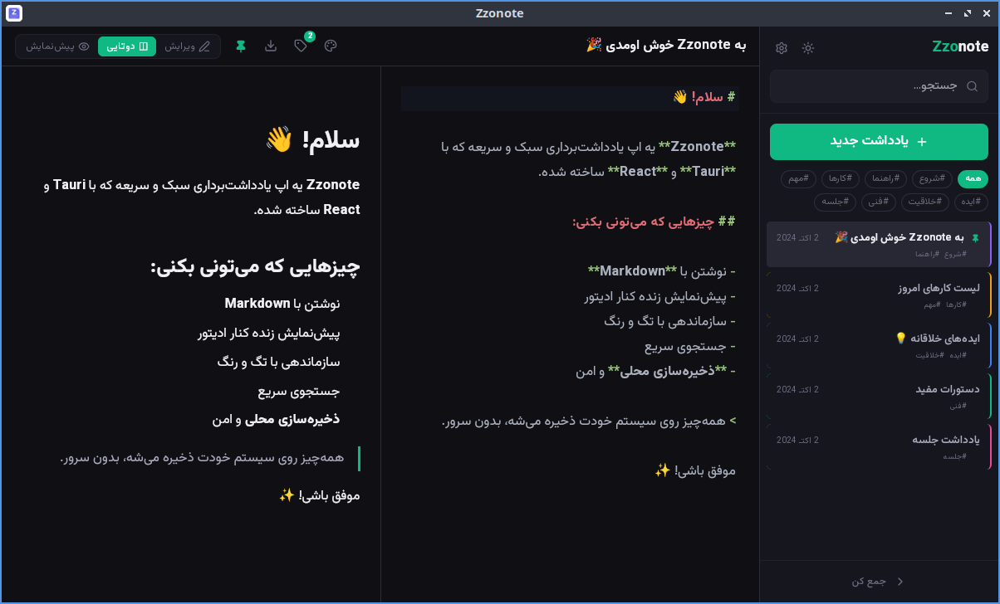

<div align="center">

# ✍️ Zzonote

**اپلیکیشن یادداشت‌برداری دسکتاپ؛ سبک، سریع و کاملاً آفلاین**

ویرایشگر WYSIWYG با پشتیبانی از Markdown، تگ‌گذاری، جدول، چک‌لیست و ذخیره‌سازی محلی

[](https://v2.tauri.app/)
[](https://react.dev/)
[](https://www.typescriptlang.org/)
[](https://tailwindcss.com/)
[](LICENSE)



[قابلیت‌ها](#-قابلیت‌ها) ·
[نصب](#-نصب) ·
[میان‌برها](#️-میان‌برهای-صفحه‌کلید) ·
[توسعه](#-توسعه) ·
[مشارکت](#-مشارکت)

</div>

---

<div dir="rtl">

## 🎯 درباره‌ی پروژه

**Zzonote** یک اپلیکیشن یادداشت‌برداری دسکتاپ است که با **Tauri 2** و **React 19** ساخته شده. هدفش ساده است: یادداشت‌هات رو سریع بنویسی، مرتب نگه داری و مطمئن باشی که همه‌چیز فقط روی دستگاه خودته.

- 🪶 **سبک:** به لطف Tauri، خروجی نهایی چند مگابایت بیشتر نیست و به‌جای Electron از وب‌ویوی سیستم استفاده می‌کند.
- 🔒 **خصوصی:** بدون سرور، بدون حساب کاربری، بدون ارسال داده به اینترنت.
- 🇮🇷 **فارسی‌محور:** پشتیبانی کامل از RTL و فونت وزیرمتن.
- ⚡ **سریع:** ذخیره‌ی خودکار و جستجوی زنده بین همه‌ی یادداشت‌ها.

---

## ✨ قابلیت‌ها

### 📝 ویرایشگر

- ویرایشگر **WYSIWYG** مبتنی بر [TipTap](https://tiptap.dev/) با پشتیبانی از Markdown
- حالت **ویرایش سورس Markdown** با [CodeMirror 6](https://codemirror.net/)
- **پیش‌نمایش زنده** و سه حالت نمایش: ویرایش / دوتایی / پیش‌نمایش
- **جدول**، **لیست وظایف (Task List)**، **هایلایت متن**، **لینک** و **تراز متن**
- **درج تصویر** همراه با **برش (Crop)**
- **بلاک کد** با رنگ‌آمیزی سینتکس (lowlight)
- منوی شناور (Bubble Menu) برای فرمت‌دهی سریع روی متن انتخاب‌شده
- **ذخیره‌ی خودکار**؛ نیازی به دکمه‌ی Save نیست
- پشتیبانی کامل از **RTL** و فونت **وزیرمتن**

### 🎨 ظاهر و شخصی‌سازی

- **تم روشن / تاریک** با یک کلیک
- **۸ رنگ Accent** قابل انتخاب
- **رنگ اختصاصی** برای هر یادداشت
- **آیکون ایموجی** برای یادداشت‌ها
- فونت و اندازه‌ی قابل تنظیم
- طراحی مینیمال و مدرن

### 🏷️ سازماندهی

- **تگ‌گذاری** و فیلتر بر اساس تگ
- **سنجاق کردن (Pin)** یادداشت‌های مهم
- **مرتب‌سازی با کشیدن و رها کردن (Drag & Drop)**
- **جستجوی زنده** بین همه‌ی یادداشت‌ها
- مرتب‌سازی خودکار بر اساس آخرین ویرایش

### 💾 داده‌ها

- **ذخیره‌سازی محلی** با Tauri Store (فایل JSON روی دیسک)
- **پشتیبان‌گیری** و **بازیابی** از فایل JSON
- **خروجی (Export)** به Markdown / HTML / PDF

### 🖥️ پلتفرم‌ها

| سیستم‌عامل | فرمت خروجی |
|:---:|:---|
| 🐧 Linux | `.deb` · `.AppImage` · `.rpm` |
| 🪟 Windows | `.msi` · `.exe` |
| 🍎 macOS | `.dmg` (Intel و Apple Silicon) |

---

## ⌨️ میان‌برهای صفحه‌کلید

| کلید | عملکرد |
|:---:|:---|
| `Ctrl` + `N` | یادداشت جدید |
| `Ctrl` + `F` | جستجو |
| `Ctrl` + `P` | سنجاق کردن یادداشت |
| `Ctrl` + `B` | بستن / باز کردن سایدبار |
| `Ctrl` + `,` | تنظیمات |
| `Delete` | حذف یادداشت |

> در macOS به‌جای `Ctrl` از `Cmd` استفاده کنید.

---

## 📦 نصب

فایل نصبی مناسب سیستم‌عامل خودت رو از بخش [**Releases**](https://github.com/pwoyam/zzonote/releases) دانلود کن.

</div>

### 🐧 Linux

```bash
# Debian / Ubuntu
sudo dpkg -i Zzonote_*_amd64.deb

# Fedora / RHEL
sudo rpm -i Zzonote-*.x86_64.rpm

# AppImage (بدون نصب)
chmod +x Zzonote_*_amd64.AppImage
./Zzonote_*_amd64.AppImage
```

<div dir="rtl">

### 🪟 Windows

فایل `.msi` یا `.exe` را دانلود و اجرا کن.

### 🍎 macOS

فایل `.dmg` را باز کن و برنامه را به پوشه‌ی Applications بکش.

---

## 🛠 توسعه

### پیش‌نیازها

- [Node.js](https://nodejs.org/) نسخه‌ی 22 یا بالاتر
- [pnpm](https://pnpm.io/)
- [Rust](https://www.rust-lang.org/tools/install) نسخه‌ی 1.77 یا بالاتر
- وابستگی‌های سیستمی Tauri: [راهنمای رسمی](https://v2.tauri.app/start/prerequisites/)

</div>

<details>
<summary><b>وابستگی‌های لازم روی Debian / Ubuntu</b></summary>

```bash
sudo apt update
sudo apt install -y libwebkit2gtk-4.1-dev build-essential curl wget file \
  libxdo-dev libssl-dev libayatana-appindicator3-dev librsvg2-dev
```

</details>

<div dir="rtl">

### اجرا در حالت توسعه

</div>

```bash
git clone https://github.com/pwoyam/zzonote.git
cd zzonote
pnpm install

# فقط فرانت‌اند (در مرورگر)
pnpm dev

# اپلیکیشن کامل دسکتاپ
pnpm tauri dev
```

<div dir="rtl">

### ساخت نسخه‌ی نهایی

</div>

```bash
pnpm tauri build
```

<div dir="rtl">

فایل‌های خروجی در مسیر `src-tauri/target/release/bundle/` قرار می‌گیرند.

### ساخت با Docker

اگر نمی‌خواهی Rust و وابستگی‌های Tauri را روی سیستم نصب کنی، می‌توانی از Docker استفاده کنی:

</div>

```bash
# ساخت ایمیج (فقط بار اول)
docker build -f Dockerfile.build -t zzonote-builder .

# ساخت برنامه
./build.sh
```

<div dir="rtl">

### اسکریپت‌ها

| دستور | توضیح |
|:---|:---|
| `pnpm dev` | اجرای Vite در حالت توسعه |
| `pnpm build` | بیلد فرانت‌اند |
| `pnpm preview` | پیش‌نمایش بیلد |
| `pnpm lint` | اجرای ESLint |
| `pnpm tauri dev` | اجرای اپ دسکتاپ در حالت توسعه |
| `pnpm tauri build` | ساخت بسته‌های نصبی |

---

## 🏗 تکنولوژی‌ها

| بخش | تکنولوژی |
|:---|:---|
| Frontend | React 19 · TypeScript · Vite |
| Styling | Tailwind CSS 3 |
| Rich-text Editor | TipTap 3 |
| Source Editor | CodeMirror 6 |
| State Management | Zustand |
| Drag & Drop | dnd-kit |
| Markdown | marked |
| Storage | Tauri Store · Tauri FS (JSON محلی) |
| Desktop Shell | Tauri 2 (Rust) |
| Icons | Lucide React · Emoji Picker |

---

## 📁 ساختار پروژه

</div>

```
zzonote/
├── .github/workflows/   # CI/CD
├── src/                 # کد فرانت‌اند (React + TypeScript)
├── src-tauri/           # کد Rust و تنظیمات Tauri
├── screenshots/         # تصاویر مستندات
├── Dockerfile.build     # محیط ساخت مبتنی بر Docker
├── build.sh             # اسکریپت ساخت با Docker
├── vite.config.ts
├── tailwind.config.js
└── package.json
```

<div dir="rtl">

---

## 🗺 نقشه‌ی راه

- [ ] همگام‌سازی اختیاری بین دستگاه‌ها
- [ ] پوشه‌بندی و دسته‌بندی سلسله‌مراتبی
- [ ] قفل یادداشت‌ها با رمز عبور
- [ ] جستجوی پیشرفته (فیلتر تاریخ، تگ ترکیبی)
- [ ] پشتیبانی از چند زبان رابط کاربری

> ایده‌ای داری؟ از بخش [Issues](https://github.com/pwoyam/zzonote/issues) پیشنهادت رو ثبت کن.

---

## 🤝 مشارکت

مشارکت شما خوشحالمان می‌کند! مراحل کار:

1. پروژه را **Fork** کن
2. یک branch جدید بساز: `git checkout -b feature/amazing-feature`
3. تغییراتت را کامیت کن: `git commit -m "Add amazing feature"`
4. به branch خودت Push کن: `git push origin feature/amazing-feature`
5. یک **Pull Request** باز کن

قبل از ارسال PR، مطمئن شو که `pnpm lint` بدون خطا اجرا می‌شود.

برای گزارش باگ، لطفاً مراحل بازتولید مشکل، سیستم‌عامل و نسخه‌ی برنامه را در Issue بنویس.

---

## 📄 لایسنس

این پروژه تحت لایسنس **MIT** منتشر شده است. جزئیات در فایل [LICENSE](LICENSE).

---

<div align="center">

اگر Zzonote برات مفید بود، با ⭐ دادن به پروژه ازش حمایت کن.

ساخته‌شده با ❤️ توسط [pwoyam](https://github.com/pwoyam)

</div>

</div>
